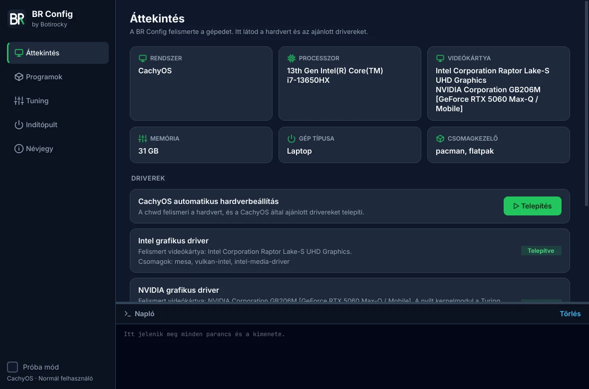

<p align="center"></p>

<h1 align="center">BR Config</h1>

<p align="center">Nyílt forrású konfigurációs központ Windowsra és Linuxra.<br>
Gépfelismerés, driverek, programtelepítés, tuning és indítópult egy helyen.</p>

<p align="center">
  <a href="https://botirocky.github.io/br-config/">Weboldal</a> ·
  <a href="https://github.com/Botirocky/br-config/releases/latest">Letöltés</a> ·
  <a href="https://github.com/Botirocky/br-config/issues">Hiba bejelentése</a>
</p>



## Mit tud

- **Gépfelismerés és driverek**: felismeri a processzort, a videókártyákat, a hálózati és hangeszközöket, és ezek alapján ajánl drivert. Linuxon a disztribúció csomagjaival dolgozik (CachyOS-en a `chwd`, Ubuntun az `ubuntu-drivers` eszközzel), Windowson a Windows Update-re és a gyártó oldalára visz.
- **Programtelepítés**: több mint 30 válogatott program, a rendszer saját csomagkezelőjével (`winget`, `pacman`, `apt`, `dnf`, `zypper`), ha kell, Flatpakkal. Egy gombbal minden frissíthető.
- **Tuning**: energiaprofilok, swappiness, TCP BBR, titkosított DNS, SSD TRIM, Windows Játék mód, egérgyorsítás, telemetria, hirdetési azonosító, valamint takarítás. Minden kapcsoló a valós állapotot mutatja, és visszaállítható.
- **Indítópult**: a bejelentkezéskor induló programok ki- és bekapcsolása, törlés nélkül.
- **Átláthatóság**: minden parancs látszik, mielőtt lefut (az egér alatt és a naplóban). Próba módban semmi nem fut le. A rendszergazdai lépések egyetlen jelszókéréssel futnak (Linuxon pkexec, Windowson UAC).

## Telepítés

**Windows 10/11**: töltsd le a `BR-Config-<verzió>-telepito.exe` fájlt a [kiadások](https://github.com/Botirocky/br-config/releases/latest) közül.

**Linux (x86_64)**:

```bash
tar xzf BR-Config-*-linux-x86_64.tar.gz
cd BR-Config-*-linux-x86_64
./telepites.sh
```

Eltávolítás: `./telepites.sh --eltavolitas`.

**Forrásból** (Python 3.12 vagy újabb, ajánlott a 3.14):

```bash
uv venv -p 3.14 && uv pip install -e ".[dev]"
uv run br-config
```

Rendszerigény: 4 GB RAM (a program kb. 100 MB-ot használ).

## Parancssor

| Parancs | Mit csinál |
|---|---|
| `br-config-cli info` | gép- és driverinformáció |
| `br-config-cli programok` | telepíthető programok |
| `br-config-cli tweakek` | tuning-beállítások és állapotuk |

## Fejlesztés

| Parancs | Mit csinál |
|---|---|
| `uv run pytest` | tesztek (a GUI-tesztek offscreen futnak) |
| `uv run ruff check src tests eszkozok` | lint |
| `uv run python eszkozok/katalogus_ellenor.py` | a katalógus azonosítóinak élő ellenőrzése |
| `uv run python eszkozok/ikonok.py` | ikonok újragenerálása a logóból |
| `uv run pyinstaller packaging/br-config.spec` | önálló csomag |

A program Python 3.15-ön a `__lazy_modules__` révén lusta importálással indul (PEP 810), a régebbi verziókon ez hatástalan. Az oldalak csak az első megnyitáskor töltődnek be.

Kiadás: egy `v*` tag pusholása után a GitHub Actions elkészíti a Windows-telepítőt, a hordozható zipet és a Linux-csomagot, SHA-256 ellenőrzőösszegekkel.

## Licenc

GPL-3.0-or-later. Készítette: **Botirocky**.
